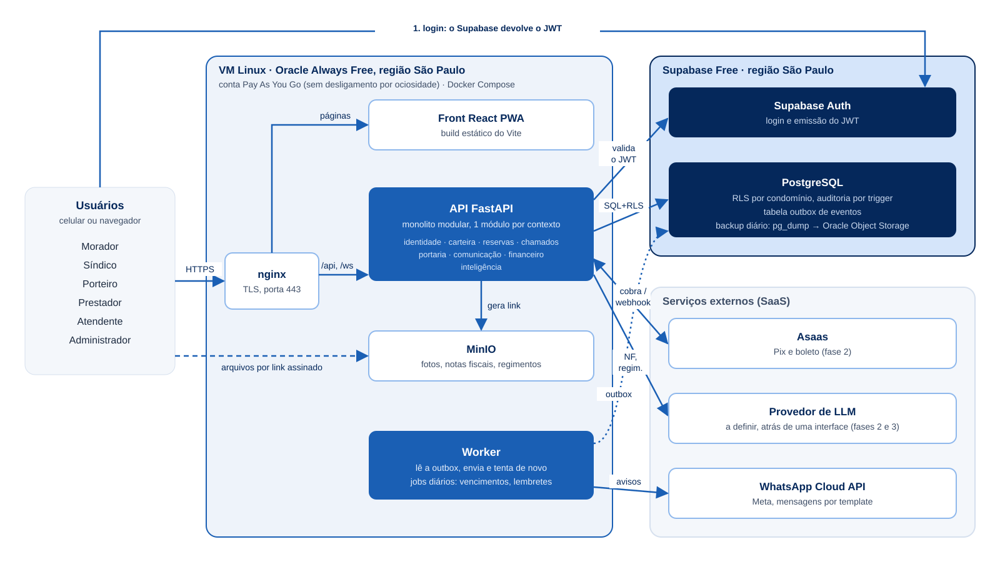

# Lumen

Plataforma de gestao de condominios: moradores, sindicos, portaria e o time de atendimento da Lumen num so lugar.

Projeto do Desafio 1 da postulacao a Tech Lead da ITA Jr. Esta e a **fundacao tecnica** (arquitetura, seguranca, um fluxo ponta a ponta e a documentacao das decisoes), nao o produto completo.

## Sumario

- [Estado atual](#estado-atual)
- [Stack](#stack)
- [Arquitetura em uma olhada](#arquitetura-em-uma-olhada)
- [Estrutura do repositorio](#estrutura-do-repositorio)
- [Rodando localmente](#rodando-localmente)
- [Variaveis de ambiente](#variaveis-de-ambiente)
- [API](#api)
- [Papeis e permissoes](#papeis-e-permissoes)
- [Seguranca e multi-tenancy](#seguranca-e-multi-tenancy)
- [Testes e CI](#testes-e-ci)
- [Backup](#backup)
- [Convencoes](#convencoes)
- [Como acrescentar uma funcionalidade](#como-acrescentar-uma-funcionalidade)
- [Documentacao](#documentacao)

## Estado atual

A Lumen e dividida em 8 contextos (DDD). Hoje:

| Contexto | Status | O que tem |
|---|---|---|
| Identidade | pronto | usuarios, vinculos (quem, onde, qual papel), `GET /me`; e-mail e telefone so aparecem para o proprio usuario e para quem gerencia o condominio |
| Carteira | pronto | condominios, unidades, areas comuns |
| Reservas | pronto | solicitar, aprovar, recusar e cancelar reserva de area comum, sem sobreposicao de horario; solicitar, aprovar, recusar e cancelar gravam um evento na outbox |
| Chamados | esqueleto | pasta e README do contexto |
| Portaria | esqueleto | idem |
| Comunicacao | esqueleto | idem (o push do PWA e o WhatsApp entram aqui, como handlers da outbox) |
| Financeiro | esqueleto | idem |
| Inteligencia | esqueleto | interface `ProvedorLLM` com provedor falso. Escolhido: Claude Haiku (plano B: GPT-5.6 Luna), ainda nao implementado ([ADR 0005](docs/decisoes/0005-llm-trocavel.md)) |

Front: login, seletor de condominio, e as telas de morador (nova reserva, minhas reservas) e de sindico (aprovar e recusar). A portaria ainda e uma tela vazia.

### Planejado, ainda nao feito

Estas decisoes estao nos documentos, mas **nao tem codigo**:

- **PWA e push:** sem manifest nem service worker. O push do PWA e o WhatsApp entram como handlers do worker da outbox, com o contexto Comunicacao.
- **Producao:** `infra/` de producao (nginx, TLS, compose de producao, limite de requisicoes) nao existe; so ha o backup. Ver [docs/seguranca.md](docs/seguranca.md).
- **Arquivos (Oracle Object Storage):** a decisao esta no [ADR 0011](docs/decisoes/0011-object-storage-da-oracle.md), mas nenhuma funcionalidade grava arquivo ainda (fotos de chamados e notas fiscais virao depois). No compose de desenvolvimento ha um S3 local so para testar.
- **Provedor de LLM real:** so existe a interface e o provedor falso.
- **Visao consolidada da Lumen:** hoje o papel de admin ou atendente e um vinculo por condominio, e a RLS enxerga um condominio por vez. Relatorios da carteira dos 40 condominios pedem uma decisao propria.
- **Contextos:** Chamados, Portaria, Comunicacao e Financeiro; convite de usuarios e CRUD de condominios e unidades.

## Stack

| Camada | Tecnologia |
|---|---|
| Back | Python 3.11+, FastAPI, SQLAlchemy assincrono, Alembic (migrations em SQL explicito), Pydantic |
| Front | React 19, Vite, TypeScript, React Router, TanStack Query |
| Banco e login | PostgreSQL 16 e Supabase Auth (JWT) |
| Arquivos | Oracle Object Storage (API compativel com S3); no dev, um S3 local |
| Hospedagem | VM Oracle Always Free (Sao Paulo) com Docker Compose e nginx; Supabase Free |
| Testes | pytest (back), Vitest (front) |
| CI | GitHub Actions |

Custo fixo previsto: R$ 0. O raciocinio esta em [docs/arquitetura.md](docs/arquitetura.md).

## Arquitetura em uma olhada



Uma requisicao, do clique ao banco:

1. O front faz login no Supabase Auth e recebe um JWT.
2. Toda chamada vai para a API com o token e o header `X-Condominio-Id` (condominio ativo).
3. A API valida o JWT, le os vinculos do usuario e monta o contexto da requisicao (papeis e permissoes).
4. O contexto carimba a transacao (`set_config('app.condominio_id', ...)`).
5. As policies de RLS do Postgres so mostram linhas daquele condominio.
6. Triggers gravam a auditoria de toda escrita.

O front nunca le o banco direto: o `supabase-js` serve so para login.

## Estrutura do repositorio

```
backend/    API em FastAPI, um pacote por contexto (DDD)
  app/core/        configuracao, seguranca (JWT), catalogo de permissoes
  app/shared/      banco, contexto da requisicao (RLS), erros, ids, middleware
  app/identidade/  usuarios e vinculos            (pronto)
  app/carteira/    condominios, unidades, areas   (pronto)
  app/reservas/    reservas de areas comuns       (pronto)
  app/jobs/        worker da outbox (python -m app.jobs.worker)
  app/chamados, portaria, comunicacao, financeiro, inteligencia
  alembic/         migrations
  tests/           pytest (RLS, API, regras de dominio)
frontend/   React + Vite + TypeScript, uma area por perfil
  src/areas/       morador, sindico, portaria, reservas
  src/contexto/    condominio ativo e papeis
  src/services/    cliente da API
docs/       arquitetura, fluxos de dados, backup e decisoes (ADRs)
infra/      roles do banco para dev e scripts de backup
```

Cada contexto do back segue o mesmo molde: `models.py` (tabelas), `schemas.py` (contratos), `domain.py` (regras puras, testaveis sem banco), `service.py` (casos de uso) e `router.py` (endpoints).

## Rodando localmente

Pre-requisitos: Docker. Para rodar sem Docker: Python com [uv](https://docs.astral.sh/uv/), Node 22 e um Postgres 16.

```bash
docker compose up
```

Sobe banco, migrations, API (`:8000`), front (`:5173`) e um S3 local de desenvolvimento (`:9001`, console). A documentacao interativa da API fica em `http://localhost:8000/docs`.

Sem Docker:

```bash
cd backend && cp .env.example .env && uv sync
uv run alembic upgrade head
uv run uvicorn app.main:app --reload

cd frontend && cp .env.example .env && npm install && npm run dev
```

**Login.** O Auth e o do Supabase, entao para entrar e preciso um projeto Supabase (o plano Free basta): preencher os dois `.env` com a URL e a chave publica, criar um usuario e vincula-lo a um condominio. O passo a passo esta em [docs/rodando-localmente.md](docs/rodando-localmente.md).

## Variaveis de ambiente

Back (`backend/.env`):

| Variavel | Para que serve |
|---|---|
| `DATABASE_URL` | conexao da API, sempre como `app_backend` (sem BYPASSRLS) |
| `MIGRATION_DATABASE_URL` | conexao das migrations, com permissao de DDL |
| `SUPABASE_URL` | origem do JWT e do JWKS |
| `SUPABASE_JWT_SECRET` | so em dev e testes (HS256); em producao, deixe vazio e use o JWKS |
| `DEBUG` | logs mais verbosos e detalhes nos erros |

Front (`frontend/.env`):

| Variavel | Para que serve |
|---|---|
| `VITE_API_URL` | endereco da API, ex.: `http://localhost:8000/api/v1` |
| `VITE_SUPABASE_URL` | URL do projeto Supabase |
| `VITE_SUPABASE_ANON_KEY` | chave publica (Publishable). **Nunca** use a chave secreta no front |

## API

Prefixo `/api/v1`. Todas as rotas exigem `Authorization: Bearer <jwt>` e, as que dependem de condominio, `X-Condominio-Id`.

| Metodo e rota | Permissao | O que faz |
|---|---|---|
| `GET /me` | autenticado | usuario e seus vinculos |
| `GET /unidades` | `unidade.ler` | unidades do condominio |
| `GET /areas-comuns` | `area_comum.ler` | areas reservaveis |
| `POST /areas-comuns` | `area_comum.gerenciar` | cria area comum |
| `POST /reservas` | `reserva.solicitar` | pede uma reserva |
| `GET /reservas` | `reserva.ler_proprias` ou `reserva.ler_todas` | lista (morador ve as suas, sindico ve todas) |
| `POST /reservas/{id}/aprovar` | `reserva.aprovar` | aprova |
| `POST /reservas/{id}/recusar` | `reserva.aprovar` | recusa |
| `POST /reservas/{id}/cancelar` | `reserva.cancelar` | cancela |

`GET /health` (sem prefixo) responde se a API esta de pe. Erros seguem um envelope unico com codigo e mensagem.

Telas e endpoints de cada funcionalidade planejada: [docs/fluxos-de-dados.md](docs/fluxos-de-dados.md).

## Papeis e permissoes

Permissoes tem o formato `recurso.acao` e vivem em tabela (`papeis`, `papel_permissoes`), semeadas pela migration a partir de [`backend/app/core/permissions.py`](backend/app/core/permissions.py).

| Papel | Pode, por exemplo |
|---|---|
| morador | solicitar, ver e cancelar as proprias reservas |
| sindico | ver todas as reservas, aprovar, gerenciar areas, ler auditoria |
| porteiro | consultar condominio e unidades |
| prestador | consultar o condominio |
| atendente, admin | papeis da equipe Lumen |

Uma pessoa pode ter varios vinculos (por exemplo, moradora em um predio e sindica em outro). Ver [ADR 0004](docs/decisoes/0004-varios-vinculos.md).

## Seguranca e multi-tenancy

O condominio e o tenant. Tres camadas, cada uma cobrindo o furo da outra:

| Camada | Onde | Protege contra |
|---|---|---|
| `RequirePermission` | API | morador tentando aprovar reserva |
| RLS por condominio | Postgres | bug que esqueca o filtro de condominio |
| FKs compostas `(id, condominio_id)` | Postgres | dado de um condominio apontando para outro |

Mais:

- A API conecta como `app_backend`, sem BYPASSRLS, e a RLS le o carimbo da transacao (GUCs). Sem carimbo, nenhuma linha (falha fechada). [ADR 0003](docs/decisoes/0003-rls-com-gucs.md)
- Auditoria por trigger no banco: grava antes e depois de toda escrita, inclusive alteracao manual. [ADR 0007](docs/decisoes/0007-auditoria-por-trigger.md)
- JWT validado por HS256 (dev) ou ES256/RS256 via JWKS, sempre com lista fechada de algoritmos.
- Ids em UUIDv7, nao sequenciais. [ADR 0006](docs/decisoes/0006-ids-uuidv7.md)

## Testes e CI

```bash
cd backend && uv run pytest     # precisa de um Postgres; ver TEST_ADMIN_DATABASE_URL em tests/conftest.py
cd frontend && npm test
```

Os testes do back cobrem isolamento por RLS, endpoints e regras de reserva. Eles conectam como `app_backend`, o mesmo usuario de producao, para a RLS ser testada de verdade.

O CI (`.github/workflows/ci.yml`) roda tres jobs a cada push: `backend` (lint e testes), `frontend` (lint, testes e build) e `backup` (faz um dump e restaura num banco limpo).

## Backup

O Supabase Free nao oferece backup para download. Por isso `infra/backup/backup.sh` faz um `pg_dump` diario (7 diarios e 4 semanais) e `restore-test.sh` prova que o dump restaura. Detalhes e como restaurar: [docs/backup.md](docs/backup.md).

## Convencoes

- Codigo e documentacao em portugues, sem acentos nos arquivos.
- Migrations em SQL explicito, uma por mudanca.
- Dinheiro em `numeric(14,2)`, datas em `timestamptz` (UTC), status como `CHECK` e nao `ENUM`.
- Regras de negocio em `domain.py`, funcoes puras.
- Toda decisao relevante vira um ADR em `docs/decisoes/`, com contexto, decisao e consequencias.

## Como acrescentar uma funcionalidade

1. Crie a migration da tabela, com `condominio_id` e a protecao em uma linha:
   ```sql
   SELECT app_preparar_tabela('minha_tabela');  -- grants + RLS + auditoria + atualizado_em
   ```
2. Acrescente as permissoes em `core/permissions.py` e atribua-as aos papeis.
3. No contexto: `models.py`, `schemas.py`, `domain.py`, `service.py`, `router.py`.
4. Registre o router em `app/main.py`.
5. Escreva os testes: regra pura em `domain`, e um teste de isolamento entre dois condominios.
6. No front, crie a tela dentro da area do perfil em `src/areas/`.

## Documentacao

1. [docs/arquitetura.md](docs/arquitetura.md): diagrama, hospedagem e como uma requisicao atravessa o sistema.
2. [docs/fluxos-de-dados.md](docs/fluxos-de-dados.md): telas e endpoints de cada funcionalidade.
3. [docs/decisoes/](docs/decisoes/): por que cada escolha foi feita (11 ADRs).
4. [docs/backup.md](docs/backup.md): backup diario do banco e como restaurar.
5. [docs/seguranca.md](docs/seguranca.md): ameacas, defesas e o que ainda esta pendente.
6. [docs/rodando-localmente.md](docs/rodando-localmente.md): como entrar na plataforma na sua maquina.
